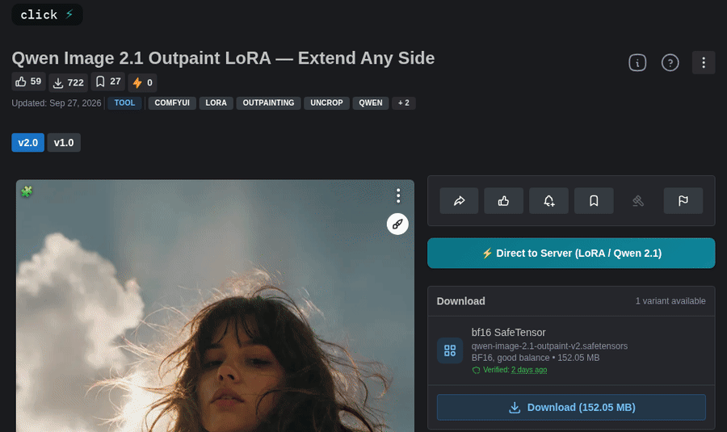

# ComfyUI-Civitai-Direct

Click a button on Civitai and the model is saved into the right ComfyUI folder.



There are two parts. A ComfyUI custom node does the downloading, and a Tampermonkey userscript adds the button to civitai.com. The node has no separate server and no settings file. It adds routes to the ComfyUI you already run and takes its folders from ComfyUI itself, so an `extra_model_paths.yaml` setup works without any extra configuration.

- Models go where ComfyUI loads them from (`loras/`, `checkpoints/`, `vae/` and so on), sorted by base model, for example `loras/sdxl/`.
- Workflows are extracted into ComfyUI's workflow library.
- A model you already have is recognized and skipped, whichever tool downloaded it or wherever you moved it.
- Every download is checked against the SHA256 that Civitai publishes.
- Each model gets a `.civitai.info` file and a preview image next to it. SD-WebUI Civitai Helper and ComfyUI Lora Manager read the same files.
- Gallery images can be saved with their prompt and ComfyUI workflow.

## Install

**1. The node.** Clone it into your ComfyUI `custom_nodes` folder and restart ComfyUI.

```bash
cd ComfyUI/custom_nodes
git clone https://github.com/ausboss/ComfyUI-Civitai-Direct
```

ComfyUI Manager can install it too: choose "Install via Git URL" and paste the repository address.

**2. The userscript.** Install [Tampermonkey](https://www.tampermonkey.net/), then open
[civitai-direct.user.js](https://github.com/ausboss/ComfyUI-Civitai-Direct/raw/refs/heads/main/userscripts/civitai-direct.user.js)
and confirm the install. In Chrome, Tampermonkey needs Developer mode (on `chrome://extensions`) or the "Allow User Scripts" switch (Chrome 138 and later) before it runs any script.

If you installed the earlier release, remove `civitai-direct-grid` and `civitai-direct-images` in Tampermonkey. Their features are part of the main script now, and the old files update to empty scripts.

## Use it

Start ComfyUI and open a model page on civitai.com. The button appears above the download box. Click it and the model downloads in the background, with progress on the button. You don't need to restart ComfyUI. Press R in the ComfyUI window to refresh its file lists.

| Button | Meaning |
|---|---|
| ⚡ Direct to Server | Ready. The label names the type and base model. |
| ⬇ 42% | Downloading. |
| ✅ Saved to Library | Done. |
| 📁 In Your Library | You already have this version. Hover for the file's path. |
| ⚡ Early Access | The version is Early Access. See below. |
| 🔌 ComfyUI Offline | No ComfyUI with this node was found. Start it and click again. |
| 🔑 API Key Needed | Civitai wants a login for this model. See the next section. |
| ❌ Request Failed | Something else went wrong. Hover for the reason. |

Model cards in listings get a small ⚡ button that downloads the newest version. Gallery images get a coloured outline showing what generation data they have (green for a ComfyUI workflow, blue for a prompt, red for nothing), buttons to copy the prompt, the parameters or the workflow nodes, and a ⬇ button that saves the image.

## API key

Civitai asks for a login before it lets you download many models, and most recent ones. Without a key the button shows 🔑 API Key Needed. Create a key at [civitai.com/user/account](https://civitai.com/user/account) under **API Keys**, then give it to the node in any one of these ways. They are checked in this order.

1. Set the `CIVITAI_API_KEY` environment variable before starting ComfyUI.
2. Put `CIVITAI_API_KEY=your-key` in a file named `.env` inside this node's folder.
3. Put just the key in a file named `civitai_api_key.txt` inside this node's folder.

The two files are read again on every download, so you can add a key and click the button again without restarting. Both are ignored by git.

To see what the node found, open `http://127.0.0.1:8188/civitai/health` (use your own port). `has_civitai_api_key` says whether a key loaded, and `api_key_source` says where from.

Early Access versions are different. They are open only to supporters, and no API key changes that. The button turns yellow on those versions, and the node reports the date the version opens to everyone if you try anyway.

## Where files go

| Civitai type | Destination |
|---|---|
| Checkpoint (SD 1.4, 1.5, 2.1, 3.x, SDXL, Pony, Illustrious) | `checkpoints/<base model>/` |
| Checkpoint (Flux, Wan, LTX and other diffusion models) | `diffusion_models/<base model>/` |
| LoRA, LyCORIS, DoRA | `loras/<base model>/` |
| Embedding | `embeddings/<base model>/` |
| VAE, ControlNet, Upscaler, Text Encoder, CLIP, Hypernetwork | the matching folder, in a `<base model>/` subfolder |
| CLIPVision, UNet, MotionModule, Detection | `clip_vision/`, `diffusion_models/`, `animatediff_models/`, `ultralytics/` |
| Workflow | `user/<user>/workflows/civitai-direct/<base model>/<workflow>/` |
| Gallery image | `<your Pictures folder>/Civitai/` |

The base-model folder is a lowercase name with no spaces, taken from Civitai's own identifiers: `sd15`, `sdxl`, `pony`, `illustrious`, `flux1`, `krea2`, `wan-video-22-t2v-a14b`. A base model the node has never seen still gets a sensible folder, because the name comes from the version's AIR identifier. If you would rather keep a flat layout, set `CIVITAI_BASE_FOLDERS=off` and models are saved straight into `loras/`, `checkpoints/` and so on.

The destination is the first folder ComfyUI lists for that type. With `extra_model_paths.yaml`, that is your own folder when you mark it `is_default: true`, and ComfyUI's `models/` folder otherwise.

Gallery images are saved as the original upload, so PNGs keep their embedded metadata. Each one comes with a `.json` file, the prompt as a `.txt` file and, when the image carries a ComfyUI graph, a `.workflow.json` you can drag into ComfyUI. Windows folders moved by OneDrive and Linux XDG folders are respected.

### Models you already have

Before downloading, the node looks in every folder ComfyUI has registered for that type, subfolders included.

- A version counts as present when a `.civitai.info` file names it, whichever tool wrote that file, or when this node's own record does.
- A file with the same name is hashed and compared with Civitai's SHA256. If the bytes match, the node adopts the file and writes the missing `.civitai.info` and preview.
- A file with the same name and different contents is a real clash, since Civitai versions often reuse names. The new file is saved as `name (1).safetensors`, and nothing is overwritten.

A download whose hash does not match Civitai's is kept as `.corrupt` and reported as an error.

## Settings

These are environment variables, or lines in the same `.env` file as the API key. They are read on every download.

```
CIVITAI_IMAGE_DIR=D:\pictures\civitai      # gallery images (default: Pictures/Civitai)
CIVITAI_WORKFLOW_DIR=D:\comfy\workflows    # workflows (default: ComfyUI's workflow library)
CIVITAI_BASE_FOLDERS=off                   # on (default) sorts by base model, off saves into <type>/
CIVITAI_SIDECARS=full                      # info (default) or full, which also writes a .json and .md record
CIVITAI_PREVIEWS=any                       # sfw (default), any (Civitai's cover image) or off
```

The default preview is the tamest picture on the version, and a model with nothing rated PG or PG13 gets no preview. To use a preview of your own, save it as `<model>.png` next to the model. The tools that read previews prefer it to the downloaded `.preview` file.

`/civitai/health` shows the folders and modes in use.

## ComfyUI on another port or computer

The userscript looks for ComfyUI on ports 8188 (the default), 8000 (the ComfyUI desktop app) and 8189, on your own computer. For anything else, open the Tampermonkey menu on a Civitai page and choose **Set ComfyUI address**, then enter something like `http://192.168.1.20:8188`. The address is saved and survives script updates. Tampermonkey asks for permission the first time it connects to a new address.

The node's routes have no login of their own. ComfyUI only listens on your own computer unless you start it with `--listen`. If you do, anyone who can reach that port can start downloads on that machine, so only do it on a network you trust.

## Troubleshooting

- **No button on any page.** In Chrome, turn on Developer mode or "Allow User Scripts" (see Install). Then check that the script is enabled for civitai.com.
- **🔌 ComfyUI Offline.** Open `/civitai/health` on your ComfyUI. If it answers with JSON, the node is fine and the script is looking on the wrong port, so use **Set ComfyUI address**. If it does not, restart ComfyUI and look for errors from `civitai-direct` in its console.
- **🔑 API Key Needed.** Add a key as described above. Check that `/civitai/health` reports it loaded, and that the same account can download the model in your browser.
- **Early Access.** Only supporters can download the version until it opens to everyone.
- **A file was saved as `name (1)`.** A different file with that name was already there.
- **A model went to the wrong folder.** Open an issue with the model's link. The mapping is in `civitai_direct/classify.py`, and adding a type or base model there is a small change.

## Privacy and safety

The node adds routes to your ComfyUI's own web server. It starts no other process and opens no other port.

**What it writes.** Only into folders taken from ComfyUI's `folder_paths`, the requesting user's workflow library, the Pictures folder for gallery images, and any folder you set with `CIVITAI_IMAGE_DIR` or `CIVITAI_WORKFLOW_DIR`. Every path part built from Civitai's data is made safe first. Workflow ZIPs are checked before extraction, so an entry cannot escape the destination, and their size and entry count are limited. Downloads go to a `.part` file that is renamed only when the transfer is complete.

**Where it connects.** Only to Civitai. You can list every address in the code:

```bash
grep -rn "https://" civitai_direct/ __init__.py
```

The only other address in the output is the link to this repository in `civitai_direct/__init__.py`. It is text in the User-Agent header, and nothing connects to it.

The node asks `civitai.com` for the model, the version and, for gallery images, the image. It downloads the file from the link Civitai gives it, which redirects to Civitai's storage. An image address sent by the browser is refused unless it is on `civitai.com`, so the key cannot be sent anywhere else. There is no telemetry, no update check and no error reporting.

**Your API key** stays in your environment or in the two ignored files. It is sent to Civitai only, as a header and as `?token=` on Civitai addresses, and the HTTP library drops the header if a redirect leaves civitai.com. It is never written into sidecars. Error messages are stripped of the token before they are stored or logged.

**The userscript** runs only on Civitai pages. It sends the model and version ids to your ComfyUI, and asks Civitai's own API for the version's type and base model in order to label the button. It can connect only to `127.0.0.1` and `localhost` unless you set another address, and Tampermonkey asks before it allows that.

**What runs.** One Python package that uses only what ComfyUI already ships (aiohttp), and one userscript. There are no compiled files, install scripts or pip installs, and both are short enough to read before you install them.

## Development

[AGENTS.md](AGENTS.md) describes the layout, the file formats other tools depend on, and how to check a change. The unit tests need ComfyUI's Python, because it has aiohttp:

```bash
python -m unittest discover -s tests -t .
```

If you keep models in more than one place, or use a layout this doesn't handle, please open an issue. The sibling project [easy-civitai-downloader](https://github.com/ausboss/easy-civitai-downloader) is a standalone server with more image and workflow tools, and this node is part of the [AusBoss](https://github.com/ausboss/ComfyUI-AusBoss) family.

## License

MIT. See [LICENSE](LICENSE).
